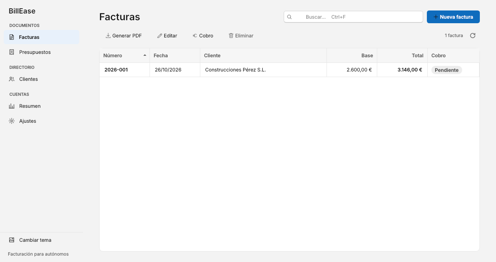
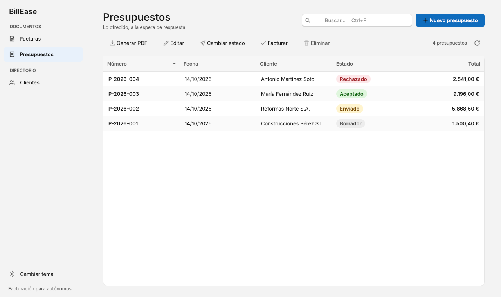
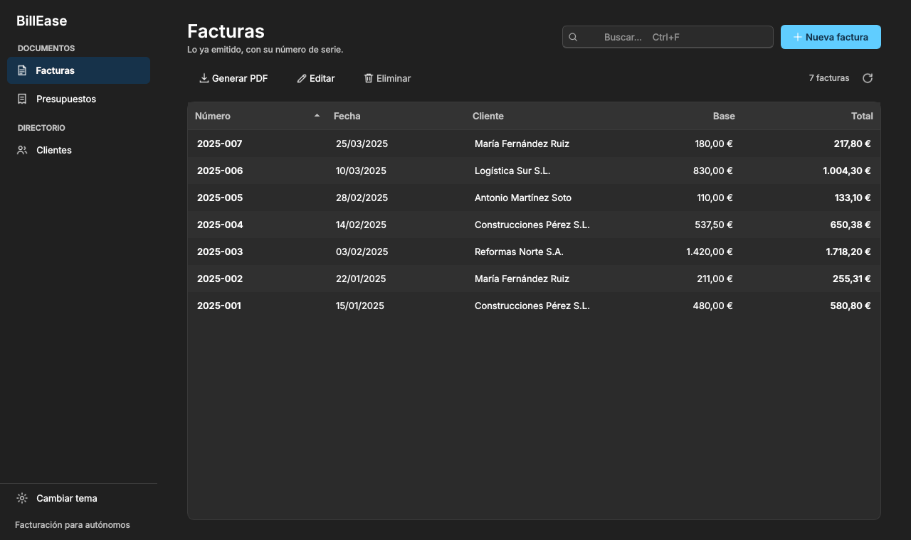
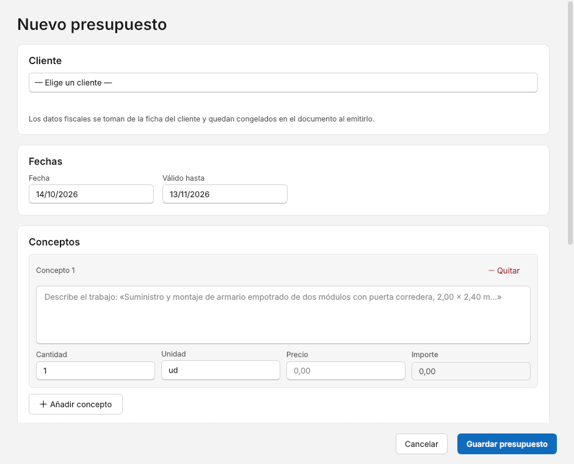
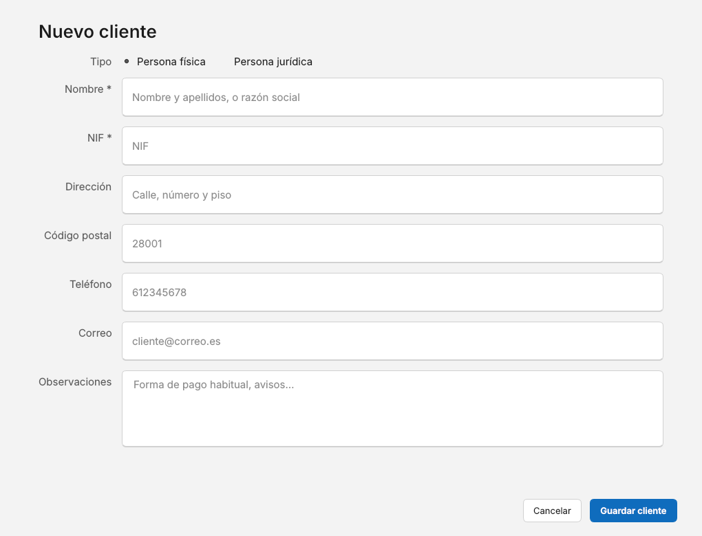
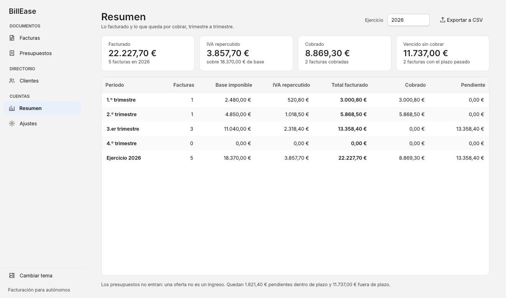
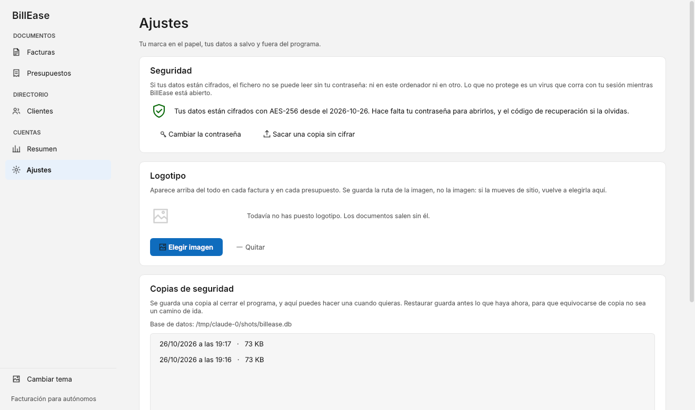

# 🧾 BillEase — Gestión de Facturas para Autónomos

> Aplicación de escritorio sencilla, moderna y pensada para que cualquier autónomo pueda gestionar sus facturas, presupuestos y clientes sin complicaciones.

---

## 📌 ¿Qué es BillEase?

**BillEase** es una aplicación de escritorio desarrollada en **Python** con interfaz gráfica **PyQt6** y base de datos **SQLite**.

Está diseñada para autónomos que necesitan una herramienta ligera y fácil de usar para:

- Tener sus datos **cifrados**: el fichero no se puede leer sin su contraseña
- Registrar y gestionar sus clientes
- Crear y editar facturas y presupuestos profesionales
- Escribir cada concepto con su cantidad, su unidad y su precio
- Saber qué está cobrado, qué está pendiente y qué se ha pasado de plazo
- Sacar el **resumen de IVA de cada trimestre** para el modelo 303
- Exportar facturas en **PDF** y los datos en **CSV** para la gestoría

No requiere conexión a internet, ni servidores externos. Todo queda guardado localmente en tu ordenador.

---

## 💻 Requisitos del sistema

| Requisito | Versión mínima |
|-----------|---------------|
| Python    | 3.11 o superior |
| Sistema operativo | Windows, macOS o Linux |

---

## ⚙️ Instalación

### 1. Clona el repositorio

```bash
git clone https://github.com/Kronos8610/BillEase.git
cd BillEase
```

### 2. Crea el entorno e instala las dependencias

```bash
python -m venv .venv
.venv\Scripts\activate        # Windows
source .venv/bin/activate      # macOS / Linux

pip install -r requirements.txt
```

> Las versiones están fijadas en `requirements.txt`. SQLite viene incluido con Python.

### 3. Ejecuta la aplicación

```bash
python main_start.py
```

La primera vez que arranques la aplicación, se mostrará un formulario de **configuración inicial** donde introducirás tus datos como autónomo (nombre, NIF, dirección, etc.). Esta información aparecerá en todas tus facturas.

### 🔐 ¿Están seguros los datos?

Sí, con dos matices que conviene decir claros.

**Lo que protege.** La base de datos se cifra con **AES-256-GCM**, y la clave que
la abre está envuelta con tu contraseña usando **Argon2id**. Con BillEase cerrado,
en el disco solo hay un fichero del que no se puede sacar ni un NIF: ni con un
visor de SQLite, ni copiándolo a otro ordenador, ni rescatándolo de un disco
viejo. Mientras el programa está abierto, la base vive **en memoria**; nunca se
escribe una copia en claro, ni siquiera temporal.

**Lo que no protege.** Un programa malicioso que corra con tu sesión mientras
tienes BillEase abierto ve los datos, porque en ese momento los estás usando tú.
Contra eso valen el antivirus y el sentido común. Y cifrar no evita *perder*
datos: para eso están las copias de seguridad, que se guardan también cifradas.

**El código de recuperación.** Al cifrar, el programa enseña **una sola vez** un
código de 32 caracteres. Es la única forma de recuperar tus facturas si olvidas
la contraseña: apúntalo en un papel y guárdalo lejos del ordenador. No cambia
aunque cambies la contraseña, así que abre también las copias antiguas.

| | |
|---|---|
| Cifrado | AES-256-GCM (autenticado: si tocan un byte, se nota) |
| Contraseña | Argon2id, 64 MiB · 3 pasadas · 4 hilos |
| Cambiar la contraseña | Instantáneo: se reenvuelve la clave, no se recifran los datos |
| Copias de seguridad | Cifradas también |
| Sacar los datos | Ajustes → «Sacar una copia sin cifrar», previa contraseña |

> **¿Por qué no SQLCipher?** Es la opción habitual, pero no publica ruedas para
> Windows en ninguna versión: habría que compilar una biblioteca en C para poder
> facturar. El cifrado va aquí dentro, con `cryptography` y `argon2-cffi`, que sí
> las publican.

Para comprobarlo tú mismo, sin fiarte del README:

```bash
python tools/verify.py --cifrado    # busca tus datos dentro del fichero cifrado
```

### ¿Dónde se guardan los datos?

La base de datos vive en la carpeta de datos de tu usuario, no junto al programa:

| Sistema | Ruta |
|---------|------|
| Windows | `%LOCALAPPDATA%\BillEase\billease.db` |
| macOS | `~/Library/Application Support/BillEase/billease.db` |
| Linux | `~/.local/share/BillEase/billease.db` |

Así la aplicación encuentra tus datos la abras desde donde la abras. Si vienes de una
versión anterior, el `BillEase.db` que tuvieras junto al programa se traslada solo la
primera vez (el original se conserva renombrado, no se borra).

Al arrancar se aplican las **migraciones** pendientes, guardando antes una copia de
seguridad con la fecha en el nombre. La variable de entorno `BILLEASE_DB` permite apuntar
a otro fichero, útil para pruebas.

### Generar el ejecutable (Windows)

Para repartirlo a alguien que no tiene Python instalado:

```bash
pip install pyinstaller
pyinstaller billease.spec          # deja dist\BillEase\BillEase.exe
```

Y para el instalador, con [Inno Setup 6](https://jrsoftware.org/isdl.php):

```bash
iscc installer\billease.iss        # deja installer\Output\BillEase-instalador-1.0.0.exe
```

El instalador copia el programa en «Archivos de programa», que es de solo lectura para el
usuario. **Los datos no van ahí**: viven en `%LOCALAPPDATA%\BillEase\`, así que
desinstalar no borra ninguna factura.

---

## 🗂️ Base de datos de prueba (opcional)

La base de datos **no se versiona**: es un fichero de trabajo, y además guardaría tus
datos reales en el repositorio. Si quieres probar el programa con contenido, genera una
base de demostración con datos ficticios:

```bash
python tools/seed_demo.py
```

Crea la base con 5 clientes y 7 facturas, en el esquema antiguo, y le aplica las
migraciones: los 8 servicios del catálogo acaban convertidos en el texto de cada
concepto. Para empezar de cero, borra el fichero y arranca la aplicación: te pedirá
tus datos de autónomo.

Para medir con una base grande:

```bash
python tools/seed_demo.py --facturas 1000 --forzar
```

Las credenciales de la base de demostración son:

| Campo | Valor |
|-------|-------|
| **Email** | carlos.garcia@billease.es |
| **Contraseña** | Pass1234 |

---

## 📸 Capturas de pantalla



> **La interfaz**, siguiendo el lenguaje visual de Windows 11:
>
> - **Navegación lateral** con las tres secciones —Facturas, Presupuestos y Clientes—, con
>   iconos propios y la sección abierta señalada. Se salta con `Ctrl+1`, `Ctrl+2` y `Ctrl+3`.
> - **Buscador** (`Ctrl+F`) que filtra por cualquier columna, sin distinguir mayúsculas ni
>   tildes: *perez* encuentra a *Pérez*.
> - **Tabla** que ordena por cualquier columna —los importes como importes y las fechas como
>   fechas— y que pinta igual de rápido con siete facturas que con mil.
> - **Barra de acciones** que solo ofrece lo que se puede hacer con la fila elegida.

Los presupuestos llevan su estado en una píldora de color, y se convierten en factura de
un clic:



El tema sigue al de Windows, y se puede cambiar a mano desde la propia navegación:



---


## 🚀 ¿Qué incluye la aplicación?

### 🏠 Panel principal
Listado de facturas, presupuestos y clientes, con búsqueda, orden por columna y las
acciones de cada documento: generar el PDF, editarlo, cambiar el estado de un presupuesto,
facturarlo o borrarlo.

### 📄 Crear factura
Formulario completo para crear facturas. Selecciona un cliente existente y **escribe
cada concepto**: la descripción entera del trabajo, su cantidad, su unidad (ud, h, m²…)
y su precio. El total se calcula mientras escribes, con IVA desglosado. No hay catálogo
que rellenar antes: el programa sugiere lo que ya has escrito otras veces, pero nunca
obliga a elegir de una lista.



### 👤 Crear cliente
Registro de clientes con soporte para **persona física** (NIF) y **persona jurídica** (CIF), con validación automática del formato fiscal español.



### 📝 Presupuestos
Presupuestos con su propia serie (`P-2025-001`), fecha de validez y estados
—borrador, enviado, aceptado, rechazado—. Un presupuesto aceptado se convierte en
factura con un clic: copia los conceptos y le asigna su número de la serie de
facturación.


### ✏️ Editar factura
Permite modificar cualquier factura existente: cambiar el cliente, las fechas, los conceptos y las cantidades.

### 🔑 Acceso y contraseña
El programa pide la contraseña al abrir, y esa misma contraseña descifra los
datos. Tras tres intentos fallidos hay que esperar, y la espera crece. Si la
olvidas, el código de recuperación entra y te deja poner una nueva.

### 📥 Exportar a PDF
Genera un PDF profesional de cualquier factura con los datos del emisor, del cliente, el
desglose de conceptos, subtotal, IVA (21%) y total. Si has puesto logotipo, encabeza el
documento.

### 📊 Resumen trimestral de IVA
Lo facturado y el IVA repercutido de cada trimestre y del año entero, que es lo que pide
el modelo 303. Los presupuestos quedan fuera: una oferta no es un ingreso. Se exporta a
CSV para mandárselo a la gestoría.



### 💶 Estados de cobro
Cada factura dice si está **cobrada**, **pendiente** o **vencida**. Lo de vencida no hay
que marcarlo: se deduce de la fecha de vencimiento, así que la lista siempre está al día
sin tocar nada.

### ⚙️ Ajustes: logotipo, copias y exportación
Tu logotipo en el papel, una copia de seguridad al cerrar —y cuando quieras—, y la
exportación a CSV de documentos, conceptos y clientes. Restaurar una copia guarda antes
lo que hubiera, así que equivocarse no es un camino de ida.



---

## 🗃️ Estructura del proyecto

```
BillEase/
├── main_start.py        # Punto de entrada de la aplicación
├── requirements.txt     # Dependencias con versiones fijadas
├── tools/               # Utilidades de desarrollo
│   ├── seed_demo.py     # Genera una base de datos de demostración
│   ├── baseline.py      # Congela el inventario de referencia
│   ├── verify.py        # Verifica los invariantes de la base
│   ├── check_contraste.py  # Ningún texto por debajo de 4,5:1 (WCAG)
│   ├── check_estilos.py    # Una sola hoja de estilos, ningún emoji
│   └── inventario.py    # Lectura del inventario (compartido)
├── docs/                # Auditoría, rediseño y ruta de trabajo
├── tests/               # Pruebas automáticas
├── core/                # Dominio: sin Qt y sin SQL
│   ├── models.py        # Documento, Linea, Cliente, Autonomo
│   ├── money.py         # Aritmética con Decimal
│   ├── taxes.py         # Base, IVA y total: el único cálculo
│   ├── numbering.py     # Serie fiscal por ejercicio
│   ├── quotes.py        # Presupuestos y su conversión en factura
│   ├── cobros.py        # Cobrada, pendiente o vencida
│   ├── reports.py       # Resumen de IVA por trimestre y por año
│   ├── cifrado.py       # AES-256-GCM + Argon2id, sin saber de SQL
│   ├── fechas.py        # ISO en la base, formato español en pantalla
│   ├── security.py      # Contraseña cifrada con Argon2
│   └── validators/      # NIF, NIE, CIF, teléfono, CP
├── data/                # Único sitio con SQL
│   ├── connection.py    # Una conexión, con claves ajenas activadas
│   ├── schema.py        # Esquema de partida
│   ├── backup.py        # Copias de seguridad, con la API de copia de SQLite
│   ├── caja.py          # La base cifrada: en memoria mientras se usa
│   ├── migrations/      # 001 … 009
│   └── repositories/    # documentos, clientes, autonomo
├── documents/
│   ├── invoice_pdf.py   # Factura y presupuesto, sin Qt
│   └── export_csv.py    # CSV para Excel en español
├── ui/                  # Pantallas
│   ├── shell.py         # Ventana principal y navegación lateral
│   ├── iconos.py        # Los iconos, en SVG propio (ya no hay emojis)
│   ├── models/          # QAbstractTableModel: listados y búsqueda
│   ├── views/           # listado · documento_editor · cliente_editor · registro
│   │                    # resumen · ajustes · acceso · seguridad
│   └── widgets/         # concepto.py (sugerencias) · pildora.py (estados)
├── theme/               # Todo el color, en un sitio
│   ├── tokens.py        # Paleta clara y oscura, sin dependencias
│   └── app.qss          # Una hoja de estilos, no 84 llamadas sueltas
├── billease.spec        # Receta de PyInstaller
└── installer/
    └── billease.iss     # Instalador para Windows (Inno Setup)
```

---

## 🛠️ Tecnologías utilizadas

| Tecnología | Uso |
|------------|-----|
| **Python 3** | Lenguaje principal |
| **PyQt6** | Interfaz gráfica de escritorio |
| **SQLite** | Base de datos local |
| **ReportLab** | Generación de PDFs |

---

## 🧰 Desarrollo

```bash
python tools/seed_demo.py                 # base de demostración con datos ficticios
python tools/seed_demo.py --sin-migrar    # …en el esquema original, para probar migraciones
python -m data.migrations --dry-run       # qué migraciones faltan
python -m data.migrations                 # aplicarlas (deja copia de seguridad)
python tools/verify.py --totales --post-migracion
python tools/verify.py --pintar           # 1.000 facturas: cuánto tarda el listado
python tools/verify.py --fiscal --copia   # el IVA cuadra y la copia se restaura
python tools/verify.py --cifrado          # nada legible sin la contraseña
python tools/check_contraste.py           # legibilidad de los dos temas
python tools/check_estilos.py             # una sola hoja de estilos, ningún emoji
pytest                                    # pruebas automáticas
```

`tools/verify.py` compara la base contra `tests/fixtures/baseline.json` y devuelve 0 si
todo está en verde. Es la puerta de verificación que usa cada fase del plan de trabajo.

**Documentación técnica** — en [`docs/`](docs/):

| Documento | Contenido |
|---|---|
| [`ANALISIS.md`](docs/ANALISIS.md) | Auditoría del código: 16 defectos verificados |
| [`RUTA.md`](docs/RUTA.md) | Plan de trabajo en 7 fases con sus verificaciones |
| [`rediseno-fluent.html`](docs/rediseno-fluent.html) | Propuesta de rediseño de la interfaz |

---

## 🔮 Futuras mejoras

> Estas mejoras están planificadas y ordenadas en [`docs/RUTA.md`](docs/RUTA.md).

Estas son algunas funcionalidades que se plantean incorporar en próximas versiones de BillEase:

### 🔒 Seguridad y cifrado de datos
- ~~Cifrado de la base de datos local~~, ~~contraseña con hash~~ y ~~acceso protegido~~ — **ya disponibles**
- Bloqueo automático tras un rato sin usar el programa
- Registro de accesos y de cambios en documentos emitidos

### 🔍 Búsqueda y filtros
- ~~Buscador en tiempo real~~ y ~~ordenación de columnas~~ — **ya disponibles**
- Filtros por fecha, importe, estado o tipo de cliente

### 🎨 Personalización de la interfaz
- ~~Modo claro y modo oscuro~~ — **ya disponible**, siguiendo al tema de Windows
- Selección del color de acento
- Posibilidad de cambiar el tamaño de fuente de la aplicación
- Guardado automático de las preferencias visuales del usuario

### 👤 Ajustes de usuario
- Pantalla de **perfil del autónomo** para modificar los datos personales (nombre, dirección, NIF, teléfono, email) sin necesidad de reinstalar
- Cambio de contraseña desde la propia aplicación
- Subida de logotipo propio para que aparezca en los PDFs generados

### 📊 Estadísticas e informes
- ~~Resumen trimestral y anual de facturación~~ y ~~exportación a CSV~~ — **ya disponibles**
- Panel de estadísticas con gráficos de ingresos por mes

### 📄 Mejoras en la generación de PDF
- ~~Logotipo del autónomo en la cabecera~~ y ~~numeración automática `2025-001`~~ — **ya disponibles**
- Plantillas de diseño seleccionables para las facturas
- Campo de número de cuenta bancaria para incluirlo en la factura

### 📧 Envío de facturas
- Envío directo de facturas por email desde la aplicación
- Historial de facturas enviadas por correo

### 🗄️ Gestión avanzada de datos
- ~~Copias de seguridad automáticas~~ y ~~facturas cobradas / pendientes / vencidas~~ — **ya disponibles**
